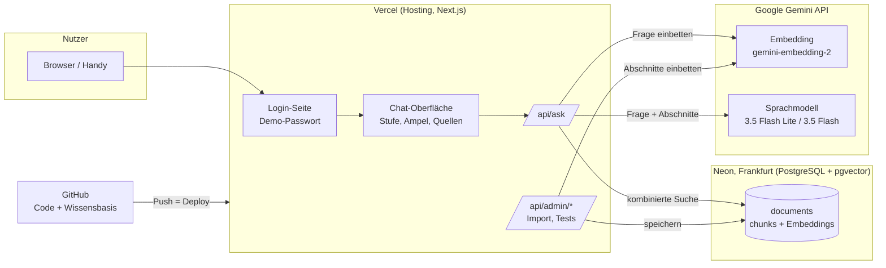

# Lösungsdokumentation Briefing-Bot (Beta v0.5)

**Stand:** 02.11.2026 · **Verantwortlich:** Deniz (Tech Lead) · **Review:** JJ (fachlich), Peri (Governance)
**Live:** https://zhaw-lnw-mod2.vercel.app (Demo-Passwort beim Team)

Der Briefing-Bot beantwortet Fragen zu Prozessen, Schnittstellen und Fachthemen der fiktiven Gletscherbank AG in drei Detailstufen (Instant, Basic, Full). Jede Antwort stützt sich ausschliesslich auf die interne Wissensbasis, nennt ihre Quellen und zeigt mit einer Konfidenz-Ampel, wie verlässlich sie ist.

---

## 1. Architektur

| Komponente | Technologie | Aufgabe | Kosten PoC |
| --- | --- | --- | --- |
| Code und Unterlagen | GitHub, Repository `dmaden87/zhaw-lnw-mod2` (öffentlich lesbar) | Versionierung, Nachweis für Dozierende | gratis |
| Web-App | Next.js 16 auf Vercel (Hobby) | Login, Chat, API | gratis |
| Vektordatenbank | Neon PostgreSQL mit pgvector, Region Frankfurt | Speichert 498 Abschnitte mit Embeddings | gratis |
| KI-Modelle | Google Gemini API, bezahlte Stufe | Embeddings und Antworten | Prepaid CHF 16 |

Prinzip: **RAG (Retrieval-Augmented Generation).** Das Sprachmodell wird nicht trainiert; es fasst nur zusammen, was die Suche in der Wissensbasis findet. Dadurch sind Antworten belegbar, und eine geänderte Weisung wirkt sofort nach dem nächsten Import.

## 2. Ablauf einer Frage

1. **Login:** Die App ist durch ein Demo-Passwort geschützt (Cookie, 30 Tage gültig). Zulässig, weil nur fiktive Daten enthalten sind; im Pilot ersetzt durch Single Sign-On.
2. **Frage und Stufe:** Nutzer wählt Instant (5–10 s Lesezeit), Basic (≤ 3 Min.) oder Full (≤ 15 Min.).
3. **Suche (ca. 0,4 s):** Die Frage wird eingebettet. Zwei Suchen laufen kombiniert: nach Bedeutung (Vektorähnlichkeit) und nach Stichworten (deutsche Volltextsuche). Die Ranglisten werden per Reciprocal Rank Fusion zusammengeführt; je nach Stufe gehen 6, 8 oder 12 Abschnitte weiter. Zusätzlich immer dabei: «Wen frage ich?» aus dem Organigramm (ORG-01).
4. **Antwort (ca. 1–2 s):** Das Sprachmodell erhält Regeln (System-Prompt), Stufe, Frage und Abschnitte und liefert ein festes Format: Antwort, Konfidenz mit Begründung, Quellen, Widersprüche, Vorschläge, Ansprechstelle.
5. **Ampel:** Die Selbsteinschätzung des Modells wird durch die Güte der Suchtreffer begrenzt (siehe Kapitel 4).
6. **Anzeige:** Antwort, Ampel, Quellen mit Owner und Stand, bei Gelb/Rot «Meinst du vielleicht …» und Ansprechstelle, Hinweis «KI-generiert – Quellen prüfen».

Gemessene Antwortzeit gesamt: **1,5–2,5 s** (Ziel Instant < 5 s erfüllt).

## 3. Wissensbasis

| Kennzahl | Wert |
| --- | --- |
| Dokumente | 60 (Prozesse, Arbeitsanweisungen, Leitfäden, Weisungen, Systemhandbücher, Produktblätter, Organigramm, Glossar, Compliance & Risk, 5 Protokolle, 5 Transkripte, 3 Schnittstellen) |
| Umfang | ca. 25'000 Wörter |
| Abschnitte (Chunks) | 498, im Schnitt 600 Zeichen, max. ca. 1'500 |
| Embedding | gemini-embedding-2, 768 Dimensionen |

**Aufbereitung** (`db/build_chunks.py`): Word-Dokumente werden in Markdown umgewandelt (`data/text/`), die Metadaten aus dem Dokumentkopf gelesen (Owner, Version/Stand, Klassifikation) und die Texte entlang der Kapitel geteilt. Grosse Tabellen werden zeilenweise geteilt, wobei der Tabellenkopf in jedem Teil erhalten bleibt. Jeder Abschnitt wird mit Dokumenttitel und Kapitel eingebettet, damit er auch allein verständlich ist.

**Schnittstellen-Dokumente:** Weil die ursprüngliche Wissensbasis kaum technische Schnittstellen enthielt, wurden drei ergänzt: IF-01 PayHub ↔ ScreenGuard (WRICEF, REST/JSON), IF-02 camt.054 (ISO 20022 XML) und IF-03 Payment Initiation API (OpenAPI/YAML).

**Import** (`/api/admin/ingest`): legt Tabellen und Indizes an und bettet Abschnitte in Paketen von 100 ein. Nur neue oder geänderte Abschnitte werden neu berechnet (Hash-Vergleich). Datenbankschema: [`db/schema.sql`](../db/schema.sql).

## 4. Konfidenz-Ampel

| Ampel | Wert | Bedeutung | Verhalten |
| --- | --- | --- | --- |
| 🟢 Sicher | ≥ 85 % | Mehrere übereinstimmende Quellen beantworten die Frage direkt | Antwort mit Quellen |
| 🟡 Ziemlich sicher | 60–84 % | Nur eine Quelle, Teilabdeckung oder Widerspruch | zusätzlich Begründung, Vorschläge, Ansprechstelle |
| 🔴 Unsicher | < 60 % | Kontext beantwortet die Frage nicht | sagt das offen, 2–3 Vorschläge, Ansprechstelle – nie eine Sackgasse |

**Berechnung:** Ampelwert = Selbsteinschätzung des Modells, begrenzt durch den besten Suchtreffer (Ähnlichkeit ≥ 0,72 → max. 100; ≥ 0,62 → max. 84; darunter → max. 59). Bei einem Widerspruch zwischen Quellen höchstens Gelb. Die Schwellen sind Startwerte und werden mit dem Testset kalibriert (Schritt 5).

**Widerspruchsregel:** Meeting-Protokoll vor Transkript, neuere Version vor älterer; jeder Widerspruch wird angezeigt.

## 5. Modellwahl

Details und Testlauf: [`modellwahl.md`](modellwahl.md).

| Aufgabe | Modell | Gemessen |
| --- | --- | --- |
| Embedding | gemini-embedding-2 | 0,3 s |
| Instant, Basic | gemini-3.5-flash-lite | 0,7 s |
| Full | gemini-3.5-flash (Thinking minimal) | 1,2 s |
| Ausweichmodell bei Überlast | gemini-flash-lite-latest | 0,8 s |

Erkenntnis: Das neueste Modell (3.8 Flash) brauchte 85 s – für den Einsatz im Meeting untauglich. Modelle werden zudem abgekündigt (2.5 Flash). Deshalb sind alle Modellnamen per Umgebungsvariable austauschbar.

## 6. Sicherheit und Datenschutz (PoC)

| Thema | Umsetzung PoC | Im Pilot |
| --- | --- | --- |
| Zugang | Demo-Passwort, Cookie mit SHA-256-Hash | Single Sign-On, Berechtigungen pro Person |
| Zugangsdaten | Nur als geschützte Umgebungsvariablen in Vercel (`DEMO_PASSWORD`, `DATABASE_URL`, `GEMINI_API_KEY`, `ADMIN_TOKEN`), nie im Repository | Secret-Management der Bank |
| Admin-Funktionen | `/api/admin/*` nur mit `ADMIN_TOKEN` | entfernt bzw. intern |
| Daten | ausschliesslich fiktive Daten der Gletscherbank | Freigegebene Dokumente nach Berechtigungs-Audit (MP-05, Gate 1) |
| KI-Anbieter | Gemini API, bezahlte Stufe: Eingaben werden nicht fürs Training genutzt | Vertrag mit Datenverarbeitung CH/EU, DSFA |
| Datenhaltung | Datenbank in Frankfurt (EU) | CH/EU gemäss DSFA |
| Transparenz | «Du sprichst mit einer KI», jede Antwort als KI-generiert gekennzeichnet (vgl. EU AI Act Art. 50) | gleich |

## 7. Betrieb

| Aufgabe | Vorgehen |
| --- | --- |
| Code ändern | Commit auf `main` → Vercel deployt automatisch (ca. 1–2 Min.) |
| Wissensbasis ändern | Dokument in `data/` ersetzen → `python3 db/build_chunks.py` → committen → nach Deploy `/api/admin/ingest?step=data` aufrufen, bis `remaining` 0 ist |
| Modell wechseln | Umgebungsvariable `EMBED_MODEL`, `GEN_MODEL_FAST`, `GEN_MODEL_FULL` oder `GEN_MODEL_FALLBACK` in Vercel setzen und neu deployen (Achtung: neues Embedding-Modell erfordert Neu-Import) |
| Diagnose | `/api/admin/ask?q=…&level=…` zeigt Suchtreffer, Scores und Zeiten; `/api/admin/search?q=…` nur die Suche; Logs im Vercel-Dashboard |
| Kosten prüfen | Google AI Studio → Nutzung; Vercel und Neon im Dashboard |

## 8. Erste Testergebnisse (02.11.2026)

| Frage | Stufe | Ergebnis | Zeit |
| --- | --- | --- | --- |
| Was passiert bei einem Timeout im Instant Payment? | Basic | 🟢 85 %, korrekt, Quellen PAY-02, IF-01, SH-01 | 2,4 s |
| Darf der KI-Assistent im Fraud-Jour-fixe mitlaufen? | Instant | 🟡 84 %, inhaltlich richtig («Nein»), Quelle nur WE-03 | 2,1 s |
| Wie hoch sind die Hypothekarzinsen? (nicht in der Wissensbasis) | Instant | 🔴 0 %, ehrlich «nicht im Kontext», 3 Vorschläge, Ansprechstelle | 1,5 s |
| Wo steht in der camt.054 die QR-Referenz? (nur Suche) | – | Top 3 Treffer alle aus IF-02 | 0,4 s |

## 9. Bekannte Schwächen und nächste Schritte

| Befund | Massnahme | Wer / bis |
| --- | --- | --- |
| Entscheid E2 aus MP-05 wird bei der Fraud-Frage nicht gefunden | Testfall aufnehmen; Suche und Abschnittsgrösse für Protokolle prüfen | JJ, Deniz / M3 22.11. |
| Bei Gelb fehlen teilweise die Vorschläge | Prompt-Regel schärfen | Deniz / M3 |
| Basic-Antwort vermischte zwei Timeout-Arten | Testfall aufnehmen, Prompt-Regel «Begriffe nicht vermischen» | JJ, Deniz / M3 |
| XML-Beispiel in IF-02 wird in der Aufbereitung zerlegt | Code-Blöcke in `build_chunks.py` erhalten | Deniz / M3 |
| Ampel-Schwellen sind Startwerte | Kalibrierung mit Testset (30 Fragen) | Peri, JJ / M4 29.11. |
| 15 Dokumente ohne Owner im Kopf (Leitfäden, Transkripte, 2 Produktblätter) | Owner ergänzen vor Freeze | JJ / M2 14.11. |
