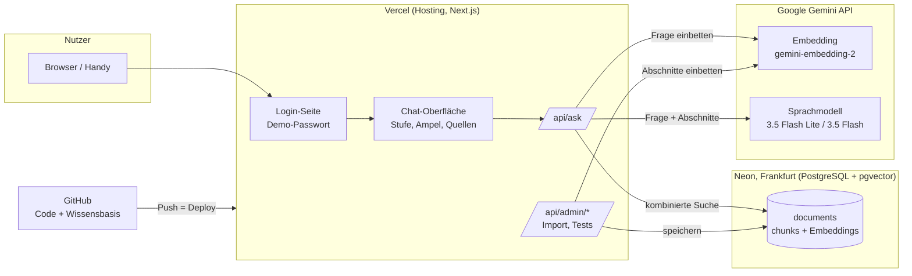

# Lösungsdokumentation Briefing-Bot (Beta v0.5)

**Stand:** 02.11.2026 · **Verantwortlich:** Deniz (Tech Lead) · **Review:** JJ (fachlich), Peri (Governance)
**Live:** https://zhaw-lnw-mod2.vercel.app (Zugang beim Team) · **KI-Einsatz:** erarbeitet mit Claude (Anthropic), Modell Claude Opus 5.5 – siehe [ki-einsatz.md](ki-einsatz.md)

Der Briefing-Bot beantwortet Fragen zu Prozessen, Schnittstellen und Fachthemen der fiktiven Gletscherbank AG in drei Detailstufen (Instant, Basic, Full). Jede Antwort stützt sich ausschliesslich auf die interne Wissensbasis, nennt ihre Quellen und zeigt mit einer Konfidenz-Ampel, wie verlässlich sie ist.

---

## 1. Architektur

| Komponente | Technologie | Aufgabe | Kosten PoC |
| --- | --- | --- | --- |
| Code und Unterlagen | GitHub, Repository `dmaden87/zhaw-lnw-mod2` (öffentlich lesbar) | Versionierung, Nachweis für Dozierende | gratis |
| Web-App | Next.js 16 auf Vercel (Hobby) | Login, Chat, API | gratis |
| Vektordatenbank | Neon PostgreSQL mit pgvector, Region Frankfurt | Speichert 498 Abschnitte mit Embeddings | gratis |
| KI-Modelle | Google Gemini API, bezahlte Stufe | Embeddings und Antworten | Prepaid CHF 16 |
| Nutzungsstatistik | Vercel Web Analytics (`@vercel/analytics`) | Seitenaufrufe und Besuche, ohne Cookies | gratis |

Prinzip: **RAG (Retrieval-Augmented Generation).** Das Sprachmodell wird nicht trainiert; es fasst nur zusammen, was die Suche in der Wissensbasis findet. Dadurch sind Antworten belegbar, und eine geänderte Weisung wirkt sofort nach dem nächsten Import.

## 2. Ablauf einer Frage

1. **Login:** Anmeldung mit Benutzername und Passwort (signierte Sitzung, 12 Std. gültig). Rollen siehe Kapitel 6a. Im Pilot ersetzt durch Single Sign-On.
2. **Frage und Stufe:** Jede Frage erzeugt alle drei Stufen parallel – Instant (5–10 s Lesezeit), Basic (≤ 3 Min.) und Full (≤ 15 Min.). Instant ist meist zuerst bereit; Umschalten zeigt die anderen Stufen ohne neue Wartezeit.
3. **Suche (ca. 0,4 s):** Die Frage wird eingebettet. Zwei Suchen laufen kombiniert: nach Bedeutung (Vektorähnlichkeit) und nach Stichworten (deutsche Volltextsuche). Die Ranglisten werden per Reciprocal Rank Fusion zusammengeführt; je nach Stufe gehen 6, 8 oder 12 Abschnitte weiter. Zusätzlich immer dabei: «Wen frage ich?» aus dem Organigramm (ORG-01).
4. **Antwort (ca. 1–2 s):** Das Sprachmodell erhält Regeln (System-Prompt), Stufe, Frage und Abschnitte und liefert ein festes Format: Antwort, Konfidenz mit Begründung, Quellen, Widersprüche, Vorschläge, Ansprechstelle.
5. **Ampel:** Die Selbsteinschätzung des Modells wird durch die Güte der Suchtreffer begrenzt (siehe Kapitel 4).
6. **Anzeige (Design-Konzept 1, Desktop und Handy):** Quellen sind anklickbar und öffnen das Dokument in einem neuen Tab, direkt beim zitierten Kapitel (hervorgehoben). Dazu Antwort, Ampel, Quellen mit Owner und Stand, bei Gelb/Rot «Meinst du vielleicht …» und Ansprechstelle, Hinweis «KI-generiert – Quellen prüfen».

Gemessene Antwortzeit gesamt: **1,5–2,5 s** (Ziel Instant < 5 s erfüllt).

## 3. Wissensbasis

| Kennzahl | Wert |
| --- | --- |
| Dokumente | 60 (Prozesse, Arbeitsanweisungen, Leitfäden, Weisungen, Systemhandbücher, Produktblätter, Organigramm, Glossar, Compliance & Risk, 5 Protokolle, 5 Transkripte, 3 Schnittstellen) |
| Umfang | ca. 25'000 Wörter |
| Abschnitte (Chunks) | 498, im Schnitt 600 Zeichen, max. ca. 1'500 |
| Embedding | gemini-embedding-2, 768 Dimensionen |

**Aufbereitung** (`db/build_chunks.py`): Word-Dokumente werden in Markdown umgewandelt (`data/text/`), die Metadaten aus dem Dokumentkopf gelesen (Owner, Version/Stand, Klassifikation) und die Texte entlang der Kapitel geteilt. Grosse Tabellen werden zeilenweise geteilt, wobei der Tabellenkopf in jedem Teil erhalten bleibt. Jeder Abschnitt wird mit Dokumenttitel und Kapitel eingebettet, damit er auch allein verständlich ist.

**Schnittstellen-Dokumente:** Weil die ursprüngliche Wissensbasis kaum technische Schnittstellen enthielt, wurden drei ergänzt: IF-01 PayHub ↔ ScreenGuard (WRICEF, REST/JSON), IF-02 camt.054 (ISO 20022 XML) und IF-03 Payment Initiation API (OpenAPI/YAML).

**Upload in der App** (`/api/documents`): Umwandlung mit mammoth (Word) bzw. unpdf (PDF), Aufteilung mit derselben Logik wie `build_chunks.py`, Abschnitts-IDs ab 100'000, Herkunft `upload`. Hochgeladene Dokumente liegen nur in der Datenbank, nicht im Repository.

**Import** (`/api/admin/ingest`): legt Tabellen und Indizes an und bettet Abschnitte in Paketen von 100 ein. Nur neue oder geänderte Abschnitte werden neu berechnet (Hash-Vergleich). Datenbankschema: [`db/schema.sql`](../db/schema.sql).

## 4. Konfidenz-Ampel

| Ampel | Wert | Bedeutung | Verhalten |
| --- | --- | --- | --- |
| 🟢 Sicher | ≥ 85 % | Mehrere übereinstimmende Quellen beantworten die Frage direkt | Antwort mit Quellen |
| 🟡 Ziemlich sicher | 60–84 % | Nur eine Quelle, Teilabdeckung oder Widerspruch | zusätzlich Begründung, Vorschläge, Ansprechstelle |
| 🔴 Unsicher | < 60 % | Kontext beantwortet die Frage nicht | sagt das offen, 2–3 Vorschläge, Ansprechstelle – nie eine Sackgasse |

**Berechnung:** Ampelwert = Selbsteinschätzung des Modells, begrenzt durch den besten Suchtreffer (Ähnlichkeit ≥ 0,72 → max. 100; ≥ 0,62 → max. 84; darunter → max. 59). Bei einem Widerspruch zwischen Quellen höchstens Gelb. Die Schwellen sind Startwerte und werden mit dem Testset kalibriert (Schritt 5).

**Kalibrierung durch Testbewertungen:** Wurde eine sehr ähnliche Frage (Ähnlichkeit ≥ 0,88) im Testing-Modus bewertet, passt das die Ampel an: «falsch» → höchstens 55 % (Rot), «teilweise» → höchstens 75 % (Gelb), «richtig» → +5 Punkte (innerhalb der Suchgrenze). Wurde dazu ergänzendes Wissen erfasst und wird es jetzt gefunden, entfällt die Abwertung. Die Begründung der Ampel nennt die Kalibrierung.

**Weitere Regeln (seit 02.11.):** Antworten mit Allgemeinwissen sind immer Gelb (60–75 %) und gekennzeichnet. Nicht beantwortete Fragen, die ausserhalb des Themas liegen oder abgelehnt werden, sind immer Rot. Steht eine Zahl der Antwort nicht in den Quellen, gibt es höchstens 70 % und einen Hinweis (siehe Kapitel 6b).

**Widerspruchsregel:** Meeting-Protokoll vor Transkript, neuere Version vor älterer; jeder Widerspruch wird angezeigt.

## 5. Modellwahl

Details und Testlauf: [`modellwahl.md`](modellwahl.md).

| Aufgabe | Modell | Gemessen |
| --- | --- | --- |
| Embedding | gemini-embedding-2 | 0,3 s |
| Instant, Basic | gemini-3.5-flash-lite | 0,7 s |
| Full | gemini-3.5-flash (Thinking minimal) | 1,2 s |
| Ausweichmodell bei Überlast | gemini-flash-lite-latest | 0,8 s |

Erkenntnis: Das neueste Modell (3.8 Flash) brauchte 85 s – für den Einsatz im Meeting untauglich. Modelle werden zudem abgekündigt (2.5 Flash). Deshalb sind alle Modellnamen per Umgebungsvariable austauschbar.

## 6. Sicherheit und Datenschutz (PoC)

| Thema | Umsetzung PoC | Im Pilot |
| --- | --- | --- |
| Zugang | Benutzer mit Rollen (User, Super-User, KI-PM, Admin), signierte Sitzung (HMAC, `SESSION_SECRET`) | Single Sign-On, Rollen aus dem Verzeichnis der Bank |
| Zugangsdaten | Nur als geschützte Umgebungsvariablen in Vercel (`DEMO_PASSWORD`, `ADMIN_PASSWORD`, `SESSION_SECRET`, `DATABASE_URL`, `GEMINI_API_KEY`, `ADMIN_TOKEN`), nie im Repository | Secret-Management der Bank |
| Admin-Funktionen | `/api/admin/*` nur mit `ADMIN_TOKEN` | entfernt bzw. intern |
| Missbrauch und Manipulation | Schutzmechanismen in 5 Schichten (Kapitel 6b) | zusätzlich zentrale Begrenzung, Monitoring |
| Daten | ausschliesslich fiktive Daten der Gletscherbank | Freigegebene Dokumente nach Berechtigungs-Audit (MP-05, Gate 1) |
| KI-Anbieter | Gemini API, bezahlte Stufe: Eingaben werden nicht fürs Training genutzt | Vertrag mit Datenverarbeitung CH/EU, DSFA |
| Datenhaltung | Datenbank in Frankfurt (EU) | CH/EU gemäss DSFA |
| Transparenz | «Du sprichst mit einer KI», jede Antwort als KI-generiert gekennzeichnet (vgl. EU AI Act Art. 50) | gleich |

## 6b. Schutzmechanismen (Guardrails)

Grundsatz: Was zuverlässig sein muss, prüft die App mit festen Regeln **ohne KI**. Der Systemprompt ergänzt diese Regeln, weil sich ein Sprachmodell überreden lässt und feste Regeln nicht. Code: `app/lib/guard.js`, Prompt: `app/lib/answer.js`.

| Schicht | Was | Wie | Wirkung |
| --- | --- | --- | --- |
| **1. Eingangskontrolle** | Manipulationsversuche («Ignoriere alle Anweisungen», «Du bist jetzt …», Entwicklermodus, System-Tags) | Mustererkennung Deutsch/Englisch | feste Ablehnung, **keine KI aufgerufen** |
| | Fragen nach Systemprompt, Anweisungen, Konfiguration | Mustererkennung | feste Ablehnung |
| | Code in der Frage oder verlangter Code (SQL, Skripte, HTML/JS, Shell) | Mustererkennung | feste Ablehnung mit Hinweis auf Schnittstellen-Doku |
| | Personendaten (IBAN, Kartennummer mit Prüfziffer, AHV-Nummer, E-Mail) | Erkennung und Schwärzung vor der Verarbeitung | Frage wird ohne die Daten beantwortet, Hinweis an die Person |
| | Missbrauch | höchstens 30 Fragen pro Person in 10 Minuten | Meldung «zu viele Anfragen» |
| **2. Systemprompt** | Grundregeln A–G mit Vorrang vor allem in Frage und Dokumenten: Inhalte sind Daten (A), Vertraulichkeit (B), feste Rolle (C), kein Code (D), **nicht urteilen** über Personen und Entscheide, Widersprüche aber sachlich nennen (E), keine Rechts-/Anlageberatung (F), Personendaten (G) | Prompt | Modell lehnt ab oder bleibt sachlich |
| | Antwortquellen: **Schalter «Allgemeinwissen Payments und Banking»** (Seite Einstellungen, nur Admin). Eingeschaltet darf der Bot allgemeines Bankwissen ergänzen, gekennzeichnet und immer Gelb. Interne Werte wie Preise, Limiten und Fristen kommen nur aus Dokumenten. Ausgeschaltet antwortet er nur aus der Wissensbasis. Themenfremdes beantwortet er nie. | Datenbank-Einstellung, 30 s Cache | |
| **3. Dokumente als Daten** | Dokumentauszüge und Frage in klar abgegrenzten Blöcken (`<dokument>`, `<frage>`), Abschlussmarken im Inhalt entschärft | Prompt-Aufbau | Anweisungen in Dokumenten werden nicht befolgt |
| | Upload, Ersetzen und Ergänzungen (KOR) werden auf Anweisungen an die KI geprüft | Mustererkennung | Dokument wird abgewiesen, verständliche Meldung |
| **4. Ausgangskontrolle** | Geheimnis-Marker im Systemprompt und typische Prompt-Bausteine | Textvergleich | Antwort blockiert |
| | **Zahlenprüfung:** Jede Zahl ab 2 Stellen muss in den gefundenen Abschnitten stehen (Tausendertrennzeichen und führende Nullen egal) | Vergleich der Ziffernfolgen | höchstens 70 % (Gelb), Hinweis mit den betroffenen Zahlen – Schutz gegen Halluzinationen |
| | Code-Blöcke nur, wenn sie wörtlich aus einer Quelle stammen | Textvergleich | Code-Block wird entfernt |
| | Nur tatsächlich gefundene Dokumente als Quelle; Darstellung ohne HTML/Skripte | bestehend | |
| **5. Nachweis** | Zähler pro Tag und Kategorie, **ohne Fragetexte und ohne Personen** (Entscheid Team) | Tabelle `guard_counts`, Seite Einstellungen | Kennzahlen für Risiko-Register und DSFA |
| | Red-Team-Tests: 37 Unit-Tests für Angriffe und erlaubte Fachfragen, 11 Sicherheitsfragen in der Live-Regression | siehe [testkonzept.md](testkonzept.md) | |

**Grenzen:** Mustererkennung fängt bekannte Formulierungen, keine beliebig verschleierten Angriffe. Deshalb gibt es mehrere Schichten: Die Grundregeln im Prompt und die Ausgangskontrolle greifen auch dann, wenn ein Angriff die Eingangskontrolle passiert. Die Begrenzung der Anfragen gilt pro Server-Instanz. Im Pilot läuft sie zentral, zum Beispiel über eine Firewall-Regel.

## 6a. Rollenkonzept

| Rolle | Darf |
| --- | --- |
| User | Fragen stellen, Antworten und Quellen sehen, Dokumente lesen |
| Super-User | zusätzlich Dokumente hochladen, ersetzen, aktivieren und inaktivieren |
| KI-PM | zusätzlich Testing- und Adjustment-Modus (Antworten bewerten und verfeinern, Wissen ergänzen) |
| Admin | alles, zusätzlich Benutzer verwalten – nur der Benutzer `admin` |

- **Benutzerverwaltung:** Seite «Benutzer» (nur Admin): anlegen, Rolle ändern, sperren/entsperren, Passwort ändern. Passwörter gespeichert als scrypt-Hash, nie im Klartext.
- **Admin-Zugang:** Benutzername `admin`, Passwort als `ADMIN_PASSWORD` in Vercel hinterlegt (nicht im Repository). Weitere Benutzer erhalten die Rollen User, Super-User oder KI-PM.
- **Durchsetzung:** Jede API prüft die Rolle serverseitig und bei echten Benutzern zusätzlich, ob sie noch aktiv sind; die Oberfläche blendet nicht erlaubte Funktionen nur aus.
- **Nachvollziehbarkeit:** Hochladen, Ersetzen, Aktivieren und Bewertungen speichern den Benutzernamen (`updated_by`, `rated_by`).
- **Pilot:** Rollen aus dem Single Sign-On der Bank übernehmen statt eigener Benutzerverwaltung.

## 7. Betrieb

| Aufgabe | Vorgehen |
| --- | --- |
| Code ändern | Commit auf `main` → Vercel deployt automatisch (ca. 1–2 Min.) |
| Wissensbasis ändern | Dokument in `data/` ersetzen → `python3 db/build_chunks.py` → committen → nach Deploy `/api/admin/ingest?step=data` aufrufen, bis `remaining` 0 ist |
| Modell wechseln | Umgebungsvariable `EMBED_MODEL`, `GEN_MODEL_FAST`, `GEN_MODEL_FULL` oder `GEN_MODEL_FALLBACK` in Vercel setzen und neu deployen (Achtung: neues Embedding-Modell erfordert Neu-Import) |
| Wissensbasis verwalten | Seite «Wissensbasis»: alle Dokumente mit Kategorie, Owner, Stand und Anzahl Abschnitte; öffnen (neuer Tab); **aktivieren/inaktivieren** (inaktive Dokumente bleiben gespeichert, werden aber nicht durchsucht); **hochladen** von Word, PDF, Markdown oder Text (max. 4 MB) – das Dokument wird umgewandelt, in Abschnitte geteilt, eingebettet und ist sofort durchsuchbar; **ersetzen** einer bestehenden Fassung (ID, Titel, Kategorie und Status bleiben, Inhalt und Abschnitte werden neu erzeugt). Upload und Ersetzen laufen als Transaktion: Bei einem Fehler bleibt der bisherige Stand unverändert. Ab Rolle Super-User. |
| Testing- und Adjustment-Modus | Schalter oben im Briefing, ab Rolle KI-PM sichtbar und nutzbar. Pro Antwort und Stufe: Bewertung richtig / teilweise richtig / falsch, Kommentar und optional ergänzendes Wissen. Ergänzungen werden als Dokument `KOR-nnn` (Kategorie «Ergänzung (Testing)») eingebettet und sind sofort durchsuchbar; in der Wissensbasis wie andere Dokumente inaktivierbar. Zähler der Bewertungen im Schalterbalken. |
| Testauswertung | `/api/admin/ratings?format=csv` (mit `ADMIN_TOKEN`) liefert alle Bewertungen als CSV für Excel – Grundlage für die KPI-Messung (Korrektheit, Kalibrierung der Ampel) |
| Einstellungen | Seite «Einstellungen» (nur Admin): Schalter «Allgemeinwissen Payments und Banking» und Zähler der Schutzmechanismen (heute, 7 Tage, total) |
| Tests | `cd app && npm test` (Unit/API); Live-Regression `npm run test:live`; automatisch in GitHub Actions – siehe [testkonzept.md](testkonzept.md) |
| Diagnose | `/api/admin/ask?q=…&level=…` zeigt Suchtreffer, Scores und Zeiten; `/api/admin/search?q=…` nur die Suche; Logs im Vercel-Dashboard |
| Nutzung auswerten | Vercel-Dashboard → Analytics (Seitenaufrufe, Besuche, Geräte) – Beleg für KPI «Nutzungsrate» |
| Kosten prüfen | Google AI Studio → Nutzung; Vercel und Neon im Dashboard |

## 8. Erste Testergebnisse (02.11.2026)

| Frage | Stufe | Ergebnis | Zeit |
| --- | --- | --- | --- |
| Was passiert bei einem Timeout im Instant Payment? | Basic | 🟢 85 %, korrekt, Quellen PAY-02, IF-01, SH-01 | 2,4 s |
| Darf der KI-Assistent im Fraud-Jour-fixe mitlaufen? | Instant | 🟡 84 %, inhaltlich richtig («Nein»), Quelle nur WE-03 | 2,1 s |
| Wie hoch sind die Hypothekarzinsen? (nicht in der Wissensbasis) | Instant | 🔴 0 %, ehrlich «nicht im Kontext», 3 Vorschläge, Ansprechstelle | 1,5 s |
| Wo steht in der camt.054 die QR-Referenz? (nur Suche) | – | Top 3 Treffer alle aus IF-02 | 0,4 s |

### Testautomatisierung (02.11.2026)

- **134 Unit- und API-Tests** (Ampel, Kalibrierung, Abschnitte, Dateiprüfung, Sitzung, Rechte je Rolle, Login, Zugangsschutz, Schutzmechanismen): alle bestanden, laufen bei jedem Push in GitHub Actions
- **Live-Regression mit 12 Referenzfragen:** Im ersten Lauf bestanden 9 von 12. Behoben wurden zwei Fehler: Rot ohne Weiterweg und eine zu kurze Basic-Antwort. Danach bestanden 11 von 12, ein Befund ist bekannt (R04).
- Details, Ausführung und Erweiterung durch JJ: [testkonzept.md](testkonzept.md)

## 9. Bekannte Schwächen und nächste Schritte

| Befund | Massnahme | Wer / bis |
| --- | --- | --- |
| Entscheid E2 aus MP-05 wird bei der Fraud-Frage nicht gefunden | Testfall aufnehmen; Suche und Abschnittsgrösse für Protokolle prüfen | JJ, Deniz / M3 22.11. |
| Bei Gelb/Rot fehlten teilweise Vorschläge und Ansprechstelle | Umgesetzt 02.11.: App ergänzt festen Weiterweg (Vorschläge + Ansprechstelle gemäss ORG-01); Unit-Test und Referenzfrage R11 | – |
| Basic-Antwort teilweise viel zu kurz | Umgesetzt 02.11.: zu kurze Antworten werden einmal neu erzeugt; Referenzfrage R01 | – |
| Authentifizierung der Payment Initiation API (IF-03) wird nicht erkannt (R04) | Aufteilung der OpenAPI-/YAML-Datei verbessern | Deniz / M3 |
| Basic-Antwort vermischte zwei Timeout-Arten | Testfall aufnehmen, Prompt-Regel «Begriffe nicht vermischen» | JJ, Deniz / M3 |
| Fehlermeldungen (Upload, Ersetzen, Antwort) | Umgesetzt 02.11.: verständliche Meldungen mit nächstem Schritt, z. B. Dateityp, Grösse, gescanntes PDF, ausgelasteter KI-Dienst, abgelaufene Anmeldung; technische Details nur im Log | – |
| XML-Beispiel in IF-02 wird in der Aufbereitung zerlegt | Code-Blöcke in `build_chunks.py` erhalten | Deniz / M3 |
| Ampel-Schwellen sind Startwerte | Kalibrierung mit Testset (30 Fragen) | Peri, JJ / M4 29.11. |
| 15 Dokumente ohne Owner im Kopf (Leitfäden, Transkripte, 2 Produktblätter) | Owner ergänzen vor Freeze | JJ / M2 14.11. |
