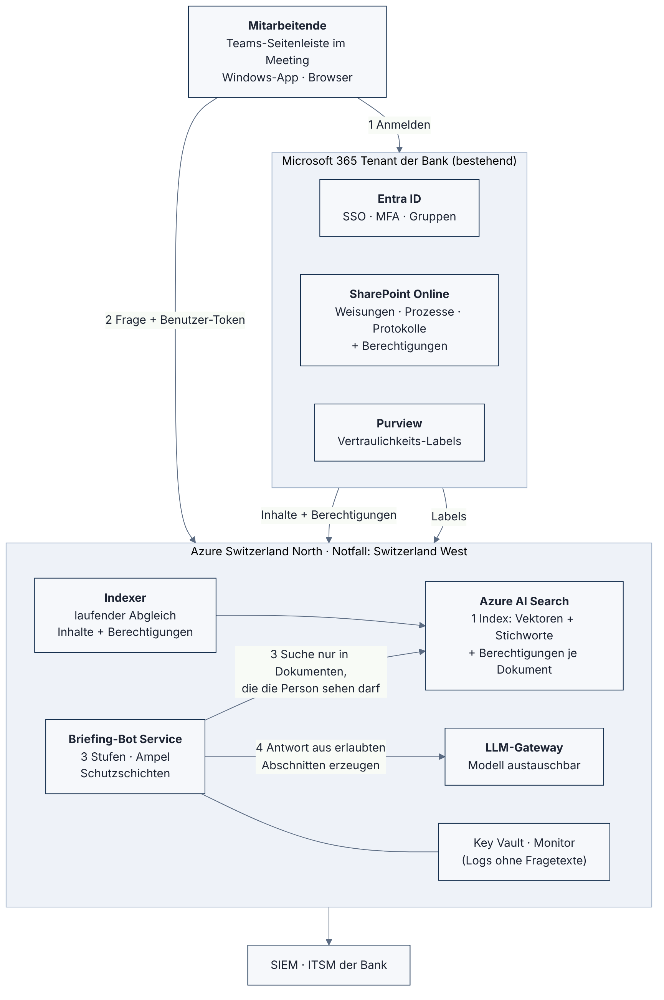

# Zielbild Betrieb: vom PoC zur produktiven Lösung

**Stand:** 20.11.2026 · **Verantwortlich:** Deniz (Architektur), Peri (Governance), JJ (Fachlichkeit) · **Status:** Entwurf für Präsentation und Pilotantrag

Der PoC (Web-App auf Vercel mit 60 fiktiven Dokumenten) macht den Nutzen greifbar. Dieses Dokument spielt durch, wie der Briefing-Bot im echten Betrieb der Gletscherbank aussehen würde: Einbettung in die bestehende IT, Anbindung der Quellen, Berechtigungen, Cloud, Betrieb und Governance.

Ausgangslage aus der Wissensbasis (fiktiv, aber verbindlich für das Szenario):
- Die Bank arbeitet mit Microsoft 365. Ablage in SharePoint, Meetings in Teams. Laut WE-03 ist Microsoft 365 Copilot im Tenant der Bank das einzige freigegebene KI-Werkzeug, aktuell im Pilot.
- Entscheide aus MP-05: Pilot mit 25 Personen ab 11.01.2027 (E1), keine KI-Begleitung bei Personal-, GwG-, Fraud- und Sanktionsthemen (E2), Transkripte werden nach 30 Tagen gelöscht (E3). Das Berechtigungs-Audit der SharePoint-Sites ist Gate 1 (E4). Go/No-Go Ende März 2027 (E5).
- WE-03: «Der KI-Assistent zeigt nur Dokumente, auf welche die Person ohnehin Zugriff hat.»

## 1. Kernaussagen

1. **Die Dokumente bleiben, wo sie sind.** Der Bot liest SharePoint (und weitere Quellen) über einen laufenden Abgleich. Es gibt keine zweite Ablage und keinen manuellen Upload mehr.
2. **Berechtigungen kommen aus der Quelle, nicht aus dem Bot.** Es gibt einen einzigen Suchindex. Jeder Abschnitt trägt die Berechtigungen seines Dokuments. Bei jeder Frage wird nur in dem gesucht, was die Person in SharePoint ohnehin sehen darf. Eine Vektor-Datenbank pro Rolle oder pro Mitarbeitendem braucht es nicht.
3. **Cloud: Microsoft Azure, Region Schweiz.** Der Grund ist nicht der Anbieter an sich, sondern die bestehende Landschaft: Identitäten (Entra ID), Dokumente (SharePoint), Labels (Purview) und Teams liegen schon im Microsoft-Tenant. Azure AI Search kann SharePoint-Berechtigungen direkt übernehmen.
4. **Offene Entscheidung: Wo läuft das Sprachmodell?** Zurzeit sind in der Azure-Region Schweiz keine aktuellen GPT-Modelle mit reiner Schweizer Verarbeitung verfügbar (Details Kapitel 5). Die Geschäftsleitung muss entscheiden, ob Verarbeitung in EU/EFTA genügt oder ob es zwingend die Schweiz sein muss.
5. **Bauen oder Kaufen wird im Pilot gemessen.** Microsoft 365 Copilot ist bereits im Pilot (WE-03). Der Briefing-Bot muss sich mit seinem Mehrwert gegen ihn behaupten: drei Stufen, Konfidenz-Ampel, Zahlenprüfung, Sackgassen-Regel, messbare Qualität.

## 2. Vom PoC zum Betrieb

| Baustein | PoC heute | Zielbild Betrieb | Warum |
| --- | --- | --- | --- |
| Dokumente | 60 fiktive Dateien, Upload über die App | SharePoint Online (+ Confluence, Teams-Protokolle) über laufenden Abgleich | eine Quelle der Wahrheit, keine Doppelablage, aktuelle Versionen |
| Berechtigungen | alle sehen alles (fiktive Daten) | Berechtigungen je Dokument aus SharePoint, Filter bei jeder Frage | Need-to-know (WE-03), Bankkundengeheimnis |
| Anmeldung, Rollen | eigene Benutzerverwaltung, Passwort | Entra ID (SSO, MFA, Conditional Access); App-Rollen über Entra-Gruppen | keine eigene Passwortverwaltung, Austritte wirken sofort |
| Suchindex | Neon PostgreSQL + pgvector | Azure AI Search (Vektoren + Stichworte + Berechtigungen) | übernimmt SharePoint-Rechte und Labels, Region Schweiz |
| Sprachmodell | Google Gemini (Prepaid) | über ein LLM-Gateway austauschbar; Azure OpenAI bzw. Foundry (Kapitel 5) | Datenresidenz, Vertrag mit bestehendem Anbieter, Modellwechsel ohne Umbau |
| Hosting | Vercel (USA/EU) | Azure Switzerland North, Notfall in Switzerland West; private Netzwerkanbindung | Datenresidenz, Netzwerk der Bank, Notfallplanung |
| Zugang | Browser | Teams-Seitenleiste im Meeting, Windows-App, Browser | dort, wo das Meeting stattfindet |
| Schutzmechanismen | 5 Schichten (Kapitel 6b Lösungsdoku) | gleich, ergänzt um Purview-Labels, DLP und Content-Filter des Anbieters | bleibt unser Kern-Mehrwert |
| Qualität | 137 Tests, Live-Regression | gleich; Regression als Pflicht-Gate vor jedem Modell- oder Prompt-Wechsel | Modelle werden abgekündigt (siehe Modellwahl) |
| Betrieb | Team, ad hoc | Betriebsorganisation mit Rollen, Prozessen, Monitoring, SLA (Kapitel 8) | FINMA-Erwartungen an Governance |

## 3. Zielarchitektur

**So läuft eine Frage ab:**
1. Die Person ist über Entra ID angemeldet, in Teams oder der Windows-App automatisch (Single Sign-On).
2. Die Frage geht zusammen mit dem Token der Person an den Briefing-Bot Service. Dort laufen zuerst die Eingangskontrollen: Manipulation, Code, Personendaten.
3. Die Suche läuft mit der Identität der Person. Azure AI Search liefert nur Abschnitte aus Dokumenten, auf welche die Person in SharePoint Leserechte hat. Dokumente mit dem Label «Streng vertraulich» sind gar nicht im Index.
4. Das Sprachmodell sieht nur diese erlaubten Abschnitte. Es kann also nichts verraten, was die Person nicht ohnehin lesen dürfte.
5. Danach folgen Ausgangskontrolle, Ampel und Quellen. Ein Klick auf eine Quelle öffnet das Original in SharePoint, und dort prüft SharePoint die Berechtigung nochmals selbst.

## 4. Datenquellen und Berechtigungen (Entitlement)

### 4.1 Quellen anbinden

| Quelle | Inhalt | Anbindung | Im Scope? |
| --- | --- | --- | --- |
| SharePoint Online: Sites Zahlungsverkehr, Compliance, IT Payments | Weisungen, Prozesse, Arbeitsanweisungen, Produktblätter, Systemhandbücher | Indexer von Azure AI Search mit Übernahme der Berechtigungen; Zugriff der App nur auf freigegebene Sites (Microsoft Graph «Sites.Selected») | Pilot |
| SharePoint: Meeting-Protokolle (MP) | Entscheide, Pendenzen | wie oben | Pilot |
| Teams-Transkripte (TR) | Gesprächsverläufe | nur mit Ankündigung und Widerspruchsrecht (WE-03), Löschung nach 30 Tagen auch im Index (E3) | Pilot, Begleitmodus |
| Confluence (IT) | Schnittstellen, technische Doku | Connector mit Berechtigungen der Bereiche | nach Pilot |
| Persönliche Quellen (Mail, Chats, OneDrive) | eigene Korrespondenz | **nicht** in den zentralen Index; bei Bedarf live über Microsoft Graph im Namen der Person (On-Behalf-Of) | V1, nach separater DSFA |
| Kundendaten (Kernbanksystem, CRM, Zahlungsaufträge) | Bankkundengeheimnis | **ausgeschlossen** | nein |

**Pflege der Quellen:** Jedes Dokument hat einen Owner, ein Gültig-ab-Datum und ein Review-Datum als SharePoint-Metadaten. Der Index übernimmt sie. Der Bot zeigt den Stand an und markiert überfällige Reviews. Das löst das PoC-Problem der 15 Dokumente ohne Owner strukturell.

### 4.2 Braucht es eine Vektor-Datenbank pro Rolle oder pro Mitarbeitendem?

**Nein.** Ein einziger Index mit **Berechtigungen als Metadaten je Abschnitt** und einem **Filter zur Abfragezeit** (Fachbegriff: Security Trimming) ist der Standard. Azure AI Search unterstützt genau das: SharePoint-Berechtigungen werden beim Indexieren als Metadaten gespeichert und bei der Abfrage durchgesetzt. Zur Abfragezeit prüft der Dienst das Entra-Token der Person und kürzt die Trefferliste auf die Dokumente, für die sie Leserechte hat.

| Variante | Beurteilung |
| --- | --- |
| **Ein Index pro Mitarbeitendem** | ✘ Bei 400 Personen und weitgehend gleichen Dokumenten wird alles bis zu 400-mal gespeichert und eingebettet. Jede Dokumentänderung muss in hunderte Indizes. Teuer, langsam, fehleranfällig. |
| **Ein Index pro Rolle** | ✘ Rollen der App (User, KI-PM) sind keine Leserechte. SharePoint-Rechte sind feiner (Site, Bibliothek, Ordner, Dokument) und ändern sich laufend. Rollen-Indizes würden diese Rechte vereinfachen und damit verfälschen. |
| **Ein Index, Berechtigungen je Abschnitt, Filter pro Frage** | ✔ Jeder Inhalt existiert einmal. Rechte kommen direkt aus SharePoint, Gruppenmitgliedschaften aus Entra ID. Neue Mitarbeitende sehen sofort das Richtige. |
| **Getrennte Indizes nach Schutzklasse** | ✔ als Ergänzung: Nur für harte Grenzen, z. B. ein separater Index für den Compliance-Bereich mit eigener Verschlüsselung. «Streng vertraulich» und Kundendaten kommen gar nicht in den Index. Die Trennung folgt der Schutzklasse, nicht der Person. |

**Was zusätzlich nötig ist:**
- **Zeitverzug bei Rechteänderungen:** Berechtigungen werden beim Indexieren übernommen. Wird ein Zugriff in SharePoint entzogen, kann die Person den Inhalt im Index noch sehen, bis der nächste Abgleich läuft. Gegenmassnahmen:
  - häufiger Abgleich der Berechtigungen, zum Beispiel alle 15 Minuten
  - vor der Antwort eine Live-Prüfung der Top-Quellen über Microsoft Graph («darf die Person dieses Dokument jetzt lesen?»)
  - Austritte und Sperrungen wirken sofort über Entra ID, weil das Token ungültig wird
- **Gate 1 bleibt entscheidend:** Der Bot macht zu breit freigegebene Sites sichtbar, weil er alles findet, was jemand lesen darf. Darum ist das Berechtigungs-Audit vor dem Pilot zwingend (MP-05, E4). Die Lösung ist nicht ein restriktiver Bot, sondern korrekte Rechte in SharePoint.
- **Geteilte Briefings und Zwischenspeicher:** Ein Briefing, das im Team geteilt wird, darf nur Inhalte zeigen, welche die empfangende Person auch lesen darf. Geteilt wird deshalb die Frage, und die Antwort wird für jede Person neu erzeugt. Zwischenspeicher (Cache) von Antworten gelten nur pro Person.
- **Rollen der App:** User, Super-User, KI-PM und Admin werden zu Entra-Gruppen. Die eigene Benutzerverwaltung des PoC entfällt. Der Super-User lädt nichts mehr hoch, sondern pflegt die Dokumente in SharePoint.

## 5. Cloud: welche und warum

### 5.1 Optionen

| | A: Microsoft Azure (Region Schweiz) + eigene App | B: Microsoft 365 Copilot / Copilot Studio (Kaufen) | C: Google Cloud (Zürich) + Gemini | D: Schweizer Hosting mit offenen Modellen |
| --- | --- | --- | --- | --- |
| **Passt zur Landschaft** | sehr gut: gleicher Tenant, Entra ID, SharePoint, Purview | sehr gut: direkt im Tenant, in Teams | mittel: Identität und SharePoint müssen angebunden werden | mittel: alles muss angebunden werden |
| **Berechtigungen** | SharePoint-Berechtigungen im Suchindex (Kapitel 4) | eingebaut: Copilot Studio respektiert die Microsoft-365-Berechtigungen, nur Dokumente mit Leserechten werden verwendet | eigene Umsetzung nötig | eigene Umsetzung nötig |
| **Datenresidenz** | Index, App und Daten in der Schweiz; Sprachmodell siehe 5.2 | In-Country-Verarbeitung für die Schweiz bis Ende 2026 angekündigt | Zürich-Region vorhanden; für aktuelle Gemini-Modelle ist dort keine garantierte Verarbeitung dokumentiert (EU-Multiregion schon) – zu prüfen | volle Kontrolle in der Schweiz |
| **Eigene Logik** (3 Stufen, Ampel, Zahlenprüfung, Regression) | voll | eingeschränkt | voll | voll |
| **Aufwand / Kosten** | mittel (Entwicklung + Betrieb) | gering bei Entwicklung, Lizenz pro Person | mittel bis hoch | hoch (Betrieb, GPU, Modellpflege) |
| **Beurteilung** | **empfohlen als Plattform** | **Messlatte im Pilot** | Kontinuität zum PoC, aber Fremdkörper in der Landschaft | Rückfall-Option, falls Verarbeitung zwingend in der Schweiz sein muss |

### 5.2 Empfehlung

**Plattform: Azure, Region Switzerland North, Notfall in Switzerland West.**
- Identität, Dokumente und Labels liegen bereits im Microsoft-Tenant der Bank. Azure AI Search übernimmt die Berechtigungen ohne eigene Programmierung.
- Azure AI Search mit Vektor- und semantischer Suche ist in beiden Schweizer Regionen verfügbar.
- Für die FINMA-Auslagerungsprüfung genügt eine bestehende Anbieterbeziehung. Ein zusätzlicher Cloud-Anbieter wäre neu zu prüfen.

**Sprachmodell: hinter einem Gateway austauschbar.** Der PoC hat gezeigt, dass Modelle schnell abgekündigt werden und das neueste nicht das schnellste ist. Zur Datenresidenz gibt es eine wichtige Einschränkung, die die Geschäftsleitung entscheiden muss:
- Nur der Bereitstellungstyp «Standard» verarbeitet Anfragen in der Region der Bereitstellung. «Global Standard» und «Data Zone Standard» garantieren keine reine Schweizer Verarbeitung.
- Zurzeit sind für «Standard» in Switzerland North keine GPT-Sprachmodelle gelistet, nur Embedding- und Sprachmodelle. GPT-5-Modelle gibt es über «Data Zone Standard» (EU).
- Microsoft zählt die Schweiz zur EU Data Boundary, Daten aus EU/EFTA-Ländern (inkl. Schweiz) können also innerhalb Europas gespeichert und verarbeitet werden.

| Entscheid GL | Folge |
| --- | --- |
| **Verarbeitung in EU/EFTA genügt** für interne, nicht kundenbezogene Dokumente | Azure OpenAI «Data Zone Standard» (EU); Index, App und Daten bleiben in der Schweiz. Einfachste Variante. |
| **Verarbeitung zwingend in der Schweiz** | ein in Switzerland North verfügbares Modell mit Standard-Bereitstellung (Embedding ist vorhanden; Chat-Modell gemäss Modellkatalog prüfen) oder Variante D. Mehr Aufwand, eventuell schwächere Modelle. |

Unsere Empfehlung: **EU/EFTA genügt** für den Briefing-Bot. Er verarbeitet nur interne Weisungen und Prozesse, keine Kundendaten (Kapitel 4.1), und Personendaten in Fragen werden vorher geschwärzt. Den Entscheid trifft die Geschäftsleitung auf Basis der DSFA (Dr. Nadia Lehmann, bis 15.12.2026).

**Bauen und Kaufen im Pilot vergleichen:** Microsoft 365 Copilot ist schon im Pilot (WE-03). Im Briefing-Bot-Pilot beantworten 25 Personen dieselben Testfragen mit beiden Werkzeugen. Gemessen werden Korrektheit, Quellen, Zeit und Nutzung. Hat der Bot keinen messbaren Mehrwert, kann er als Copilot-Studio-Agent weiterleben. Die Wissensbasis, das Testset und die Schutzregeln bleiben dabei wertvoll.

## 6. Einbettung in die Unternehmenslandschaft

| Bereich | Umsetzung |
| --- | --- |
| **Identität** | Entra ID: Single Sign-On, MFA, Conditional Access (nur verwaltete Geräte); App-Rollen über Gruppen; Austritte über den bestehenden Joiner-Mover-Leaver-Prozess |
| **Zugang im Meeting** | Teams-App mit Seitenleiste: Die Seitenleiste kann während des Meetings jederzeit geöffnet werden. Dazu Teams-Chat für Fragen ausserhalb von Meetings, Windows-App mit Tastenkürzel, Browser |
| **Netzwerk** | Dienste nur über private Endpunkte im Netz der Bank, kein öffentlicher Zugriff; Ausgang zum Sprachmodell über das Gateway |
| **Schlüssel** | Azure Key Vault; keine Schlüssel im Code (wie im PoC: nur Umgebungsvariablen) |
| **Datenschutz und Klassifikation** | Purview-Labels steuern, was in den Index darf; DLP-Regeln gegen Kundendaten; Löschfristen aus WE-03 auch im Index (Transkripte 30 Tage) |
| **Protokollierung** | technische Logs und Zähler der Schutzmechanismen ins SIEM; Fragetexte grundsätzlich nicht gespeichert (Team-Entscheid). Für den Pilot klären, ob eine kurze, zweckgebundene Speicherung für die Qualitätssicherung nötig ist, gemäss DSFA |
| **Störungen** | Meldung «falsche Antwort» und Incidents ins ITSM der Bank; Zuständigkeit gemäss Betriebsmodell (Kapitel 8) |
| **Entwicklung und Auslieferung** | Code im Repository der Bank; automatische Tests und Live-Regression als Pflicht-Gate; Test- und Produktionsumgebung getrennt |
| **Notfall** | zweite Region Switzerland West; Index aus SharePoint jederzeit neu aufbaubar (keine eigenen Originaldaten); Ausfall des Bots ist kein Geschäftsunterbruch, weil die Dokumente in SharePoint bleiben |

## 7. Governance und Regulatorik

| Vorgabe | Bedeutung für den Briefing-Bot |
| --- | --- |
| **FINMA-Aufsichtsmitteilung 08/2024** (Governance und Risikomanagement beim Einsatz von KI) | Eintrag ins KI-Inventar der Bank, klare Verantwortlichkeiten (Kapitel 8), dokumentierte Tests und Qualitätsmessung (Testkonzept, Regression), Erklärbarkeit (Quellen, Ampel-Begründung), Überwachung im Betrieb |
| **FINMA-Rundschreiben 2018/3 Outsourcing** | prüfen, ob eine wesentliche Funktion ausgelagert wird. Der Bot unterstützt nur, die Weisungen bleiben massgebend. Voraussichtlich keine wesentliche Funktion, aber Eintrag ins Auslagerungsinventar und Nutzung des bestehenden Microsoft-Vertragswerks |
| **FINMA-Rundschreiben 2023/1** (Operationelle Risiken und Resilienz) | IKT-Risiken, Notfallplanung, Abhängigkeit vom Modellanbieter (darum Gateway und austauschbares Modell) |
| **revDSG** | DSFA vor dem Pilot (MP-05), Information der Mitarbeitenden, Widerspruchsrecht bei Meeting-Begleitung (WE-03) |
| **Bankkundengeheimnis** | Kundendaten nicht im Scope; Schwärzung von IBAN, Kartennummern und AHV-Nummern in Fragen; DLP |
| **EU AI Act** (freiwillige Orientierung) | Transparenz: Antworten sind als KI-generiert gekennzeichnet, mit Quellen |
| **Mitwirkung** | Information der Personalkommission (Pendenz MP-05), keine Leistungs- oder Verhaltensauswertung (nur Zähler, keine Fragetexte) |

## 8. Betriebsmodell

| Rolle | Aufgabe | Im Szenario |
| --- | --- | --- |
| **Business Owner** | Nutzen, Budget, Go/No-Go | COO (Thomas Brunner) |
| **Product Owner** | Backlog, Prioritäten, KPI | JJ (Product Manager) |
| **KI-PM / Qualitätsverantwortliche** | Testset, Bewertungen, Ampel-Kalibrierung, Freigabe von Modell- und Prompt-Wechseln | JJ mit Fachexperten |
| **Wissens-Owner** | Inhalt und Aktualität der Dokumente in SharePoint | Owner gemäss ORG-01 |
| **Plattform-Team** | Azure-Betrieb, Index, Gateway, Deployments, Monitoring | IT Payments / Cloud-Team |
| **Risk, Compliance, Datenschutz** | DSFA, KI-Inventar, Auslagerung, Kontrollen | Peri, Datenschutzberatung, Compliance |
| **Informationssicherheit** | Berechtigungs-Audit, SIEM, Penetrationstest | ISO |

**Laufende Prozesse:**
- **Wissen pflegen:** Review-Datum je Dokument. Der Bot meldet Widersprüche und überfällige Dokumente an die Owner.
- **Qualität sichern:** Die Live-Regression läuft werktags. Bewertungen aus dem Testing-Modus fliessen in das Testset. Monatlich gibt es einen Qualitätsbericht mit Korrektheit, Sackgassen und Zählern der Schutzmechanismen.
- **Modelle wechseln:** Jeder Wechsel von Modell oder Prompt geht durch die Regression und wird von KI-PM und Product Owner freigegeben. Abkündigungen der Anbieter werden überwacht.
- **Störungen beheben:** Eine gemeldete falsche Antwort wird als Incident erfasst. Je nach Ursache korrigiert der Wissens-Owner das Dokument oder der KI-PM ergänzt das Testset.

## 9. Fahrplan

| Phase | Zeitraum | Inhalt |
| --- | --- | --- |
| **PoC** | Nov. 2026 | Web-App mit fiktiven Daten, Nutzen und Qualitätsmessung belegt (dieses Projekt); Fachtest: 97 % korrekt, 100 % richtige Quelle |
| **Vorbereitung** | Dez. 2026 | DSFA (15.12.), Berechtigungs-Audit SharePoint als Gate 1 (18.12.), Wissens-Owner der Pilot-Dokumente bestätigt, Entscheid Datenresidenz, Azure-Grundaufbau, Entra-App, Index für 3 Sites |
| **Pilot** | ab 11.01.2027 (Fragen-Modus), ab 01.02.2027 (Begleitmodus) | 25 Personen aus PayOps und Kundenservice; Teams-Seitenleiste; Briefing-Bot und Copilot-Agent beantworten dieselben 30 Fachfragen, gemessen an denselben Muss-Anforderungen und KPIs |
| **Go/No-Go** | Ende März 2027 | KPI-Review (MP-05, E5): Korrektheit, Nutzung, Zeitersparnis, Sackgassen, Vorfälle; Wahl der Variante (Briefing-Bot oder Copilot-Agent) |
| **Rollout** | ab Q2 2027 | ca. 400 Mitarbeitende, weitere Quellen (Confluence), Windows-App |
| **V1** | ab 2028 | persönliche Quellen nach separater DSFA; optional Produkt für weitere Banken |

## 10. Entscheide für die Geschäftsleitung

Diese vier Entscheide beantragt das Projektteam in der Präsentation (Kapitel 6):

1. **Pilot freigeben:** 25 Personen ab 11.01.2027, ≈ CHF 41'000 (Alternativen: verschieben, ablehnen).
2. **Lösung:** Briefing-Bot und Microsoft 365 Copilot im Pilot an denselben Muss-Anforderungen messen, statt jetzt festzulegen (Alternativen: nur Copilot, nur Briefing-Bot).
3. **Datenresidenz des Sprachmodells:** EU/EFTA genügt für interne Dokumente (Alternative: zwingend Schweiz).
4. **Voraussetzungen:** DSFA, Berechtigungs-Audit und bestätigte Wissens-Owner vor dem Start (Gate 1) (Alternative: parallel zum Pilot).

Weitere Punkte, die im Rahmen der Vorbereitung zu klären sind:
- **Scope der Quellen im Pilot:** 3 SharePoint-Sites Zahlungsverkehr, Compliance und IT Payments; Kundendaten ausgeschlossen.
- **Protokollierung:** nur Zähler (heute) oder eine zweckgebundene, befristete Speicherung von Fragen für die Qualitätssicherung?

## Quellen

- Microsoft Learn: [Document-level access control in Azure AI Search](https://learn.microsoft.com/en-us/azure/search/search-document-level-access-overview) · [SharePoint ACL-Indexierung](https://learn.microsoft.com/en-za/azure/search/search-indexer-sharepoint-access-control-lists) · [Abfragezeit-Durchsetzung](https://learn.microsoft.com/en-us/azure/search/search-query-access-control-rbac-enforcement)
- Microsoft ISE Dev Blog (30.04.2026): [Propagating SharePoint Document Permissions to AI Search and RAG Pipelines](https://devblogs.microsoft.com/ise/sharepoint-doc-level-access/)
- Microsoft Learn: [Azure AI Search Regionen](https://learn.microsoft.com/azure/search/search-region-support) · Q&A [GPT Standard deployments in Switzerland North](https://learn.microsoft.com/en-au/answers/questions/5933839/clarification-needed-gpt-standard-deployments-in-s) · Q&A [Migration GPT-4o Switzerland North](https://learn.microsoft.com/en-us/answers/a/12795573)
- Microsoft (Feb. 2026): [How Microsoft is addressing digital sovereignty in Switzerland](https://news.microsoft.com/source/emea/2026/02/how-microsoft-is-addressing-digital-sovereignty-in-switzerland/)
- Microsoft Learn: [SharePoint knowledge sources in Copilot Studio](https://learn.microsoft.com/en-us/troubleshoot/power-platform/copilot-studio/knowledge/sharepoint-no-response) · [Teams meeting extensions](https://docs.microsoft.com/microsoftteams/platform/apps-in-teams-meetings/design/designing-apps-in-meetings)
- Google Cloud: [Vertex AI Data residency](https://cloud.google.com/vertex-ai/generative-ai/docs/learn/data-residency)
- FINMA: [Aufsichtsmitteilung 08/2024](https://www.finma.ch/de/news/2024/12/20241218-mm-finma-am-08-24/) · [Cyberrisiken und Outsourcing (2024)](https://www.finma.ch/de/dokumentation/dossier/dossier-cyberrisiken/cyberrisiken-und-outsourcing-2024/)
- Wissensbasis Gletscherbank (fiktiv): MP-05, WE-03, ORG-01
- Stand der Cloud-Angaben: 20.11.2026. Modellverfügbarkeit ändert sich laufend und ist vor dem Pilot erneut zu prüfen.
